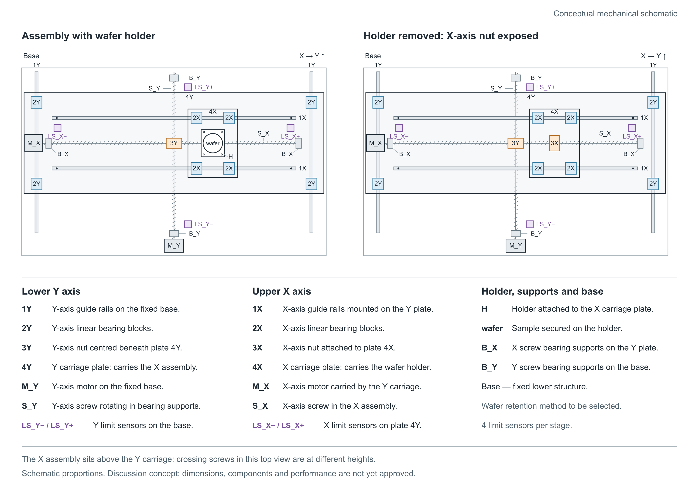
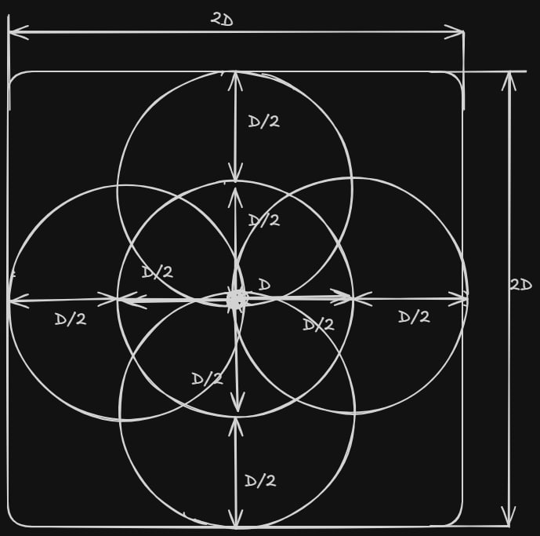

# Technical Assignment — Wafer XY Positioning Stage

Version: 0.6, 2026-11-13. Status: working draft for SPICE review before implementation. User decisions, the existing mechanical architecture and questions requiring SPICE input are recorded below. The updated component proposal is pending. Formal SPICE approval is pending.

## 1. General Information

### 1.1. Project Name

**SPICE — Wafer XY Positioning Stage.**

The platform is being developed for use with the SPICE student lithography system at VUT FEKT.

### 1.2. Developers

| Name | Identification number |
|---|---|
| Riabchuk Rostyslav | 271078 |
| Yeriemieiev Daniil | 272711 |

### 1.3. SPICE Representatives for Discussion and Coordination

| Name | Identification number |
|---|---|
| Kokoška Tibor | 256651 |
| Hoferica Damián | 257641 |
| Lev Lukáš | 256660 |
| Novák Vít | 257548 |

Individual responsibilities and the final approval procedure are to be agreed.

### 1.4. Basis for Development

The project task is to develop a controlled wafer positioning platform for the SPICE student lithography system. The platform shall move the wafer along the X and Y axes to bring selected wafer areas into the exposure region. Development covers the mechanical platform, electronics and control software.

### 1.5. Current Scope

This technical assignment covers positioning along the **X and Y axes**. Requirements for motion along the Z axis may be added through a future agreed revision of this document.

### 1.6. Purpose of This Document

Provide the SPICE representatives with a coherent basis for reviewing the proposed platform before implementation. The document will bring together the intended product, mechanical and functional architecture, requirements, proposed components and purchases with hyperlinks, supporting reasoning, open questions and verification approach.

The review should identify required corrections, clarify requirements, evaluate whether the proposed construction and components are suitable, and establish the agreed basis for proceeding with implementation. Approval of the proposal is separate from later acceptance of the completed platform.

## 2. Purpose and Goals

### 2.1. Purpose

Provide active student members of the SPICE team with a standalone device for controlled positioning of selected wafer areas for lithographic exposure.

The platform shall operate as a separate device that interacts with the lithography system. The intended product is a separate positioning apparatus rather than a mechanism built into the lithograph.

### 2.2. Expected End Result

An assembled, functional XY positioning platform with control, suitable for use as a separate device in cooperation with the SPICE lithography system.

The initial platform is controlled from a computer. The physical, electrical and software interfaces with the lithograph require SPICE input, including agreement on which team is responsible for defining them.

### 2.3. Intended Users

Students who actively participate in the SPICE student team.

### 2.4. Confirmed Initial Capability

Controlled movement between selected, separate wafer areas for exposure.

Additional first-version capabilities will be specified after discussion. The detailed operating sequence and coordination between motion and exposure remain to be agreed.

## 3. Technical Requirements and Architecture

### 3.1. Existing Mechanical Architecture

The existing stacked Cartesian XY architecture is the basis of the construction proposal. The lower Y carriage carries the X-axis assembly, including its motor. The upper X carriage carries the wafer holder. Each axis uses guides, bearing blocks and a screw/nut drive.

[Vector drawing: SVG](../hardware/concept/wafer-xy-stage-labeled-en.svg). This architecture is proposed for SPICE review. Detailed dimensions and component choices will be evaluated against the updated proposed purchase list. The illustrated holder does not prescribe vacuum retention; initial test fixation is specified in Section 3.2.

### 3.2. Wafer, Travel and Initial Fixation

| Parameter                                                    | Value or decision          | Status                         |
| ------------------------------------------------------------ | -------------------------- | ------------------------------ |
| Maximum wafer diameter                                       | 100 mm                     | User-confirmed input           |
| Additional samples                                           | Wafer fragments            | User-confirmed input           |
| X displacement of wafer centre from its central position     | -50 mm to +50 mm           | User-confirmed on 2026-11-13   |
| Y displacement of wafer centre from its central position     | -50 mm to +50 mm           | User-confirmed on 2026-11-13   |
| Total useful travel per axis                                 | X: 100 mm; Y: 100 mm       | User-confirmed on 2026-11-13   |
| Bounding dimensions of the area occupied by the moving wafer | 200 mm x 200 mm            | User-confirmed on 2026-11-13   |
| Wafer fixation for initial tests                             | Double-sided adhesive tape | User-reported team instruction |

The 200 mm x 200 mm figure describes the bounding dimensions of the wafer's swept region. Plates, guides, motors, supports, cabling and other hardware require their own space. Guide and screw lengths will be established from the construction and required useful travel.

User-supplied dimensional sketch:

### 3.3. Control

Initial control shall be from a computer. Local manual controls, such as buttons or a handwheel, are a possible later enhancement; their implementation is not required for the initial version. The computer connection, command format, operating software and supported movement modes remain to be defined.

### 3.4. Motion Performance for SPICE Review

The user's provisional desired positioning-error target is approximately **1 micrometre or less**. This is a design aspiration for review, not a measured result or an established physical limit of the available construction.

The SPICE reviewers are asked to define or confirm the relevant accuracy measure and tolerance, repeatability, minimum reliable movement, speed, settling time and permissible movement during exposure. Test conditions and means of verification must be agreed together with the applicable targets.

### 3.5. Questions Requiring SPICE Input

| Topic | Decision or information requested |
|---|---|
| Interface responsibility | Should the stage developers define the stage-to-lithograph interface, or will the lithograph team supply the specification? |
| Physical arrangement | Required placement relative to the optics, mounting/reference surfaces, permitted dimensions and height of the wafer surface. |
| Electrical and software interaction | Required connection, commands/status signals and responsibility for coordinating movement with exposure. |
| Motion performance | Confirm or revise the provisional positioning-error target and specify the other parameters in Section 3.4. |
| Further exposure functions | Decide whether automatic field stitching or multilayer alignment is required, and allocate responsibilities if included. Neither is currently an adopted requirement. |
| Handover and verification | Agree what supporting documentation and completed-platform checks are expected. |

## 4. Work Scope

Development of the standalone XY positioning platform covers its mechanical construction, electronics and computer-based control. Detailed development stages, schedule and division of work are maintained as internal planning and are omitted from the current review proposal.

## 5. Verification and Acceptance

To be developed through discussion:

- **Review before implementation:** assess the proposed architecture, construction, requirements and components; resolve concerns and record agreed changes.
- **Completed-platform checks and supporting documentation:** the expected scope is a question for discussion with the SPICE representatives. Detailed procedures and a formal documentation package have not yet been agreed.

## Appendix A. Proposed Purchases and References

[Separate proposed purchase list](../hardware/purchase-list.md).

To be populated after the partner's updated list is received and reviewed. Record the proposed item, its function, quantity, key specifications, supplier and datasheet hyperlinks, available price information, compatibility concerns and review status. The list forms part of the proposal for SPICE review.

## Budget for Review

Available budget: ____________________    Currency: ____________________
